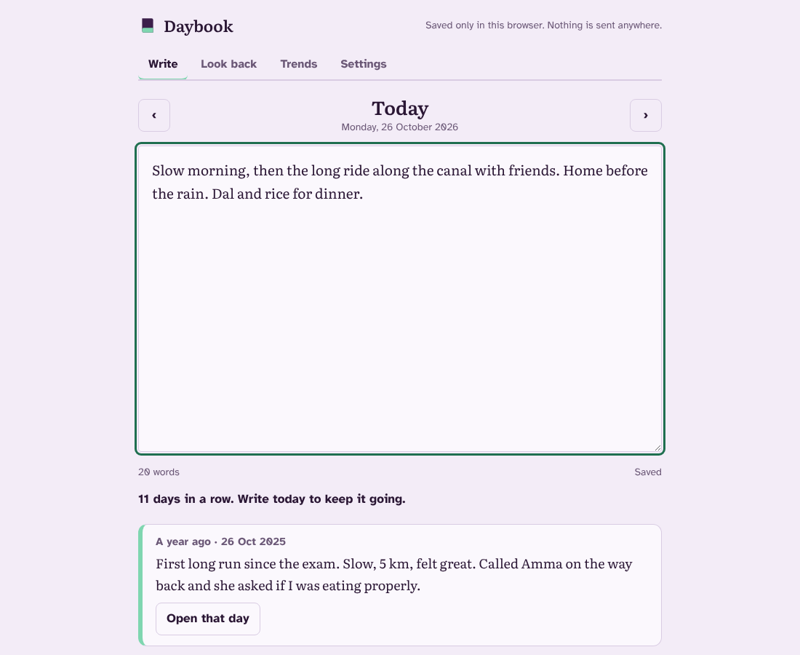

# Daybook

A private daily journal. Write a few lines each day, and Daybook shows you what you wrote on the same day in earlier years. It runs entirely in your browser: no server, no account, nothing you write is sent anywhere.

A student rebuild of the idea behind **OhLife**, the email journal that closed in October 2014. OhLife emailed you every evening ("How was your day?"), your reply became that day's entry, and each email included the entry from a year earlier. Others have since built their own replacements. Daybook keeps the writing and the look-back and drops the email, because reading and replying to mail needs a server and access to your inbox.

**Live demo:** https://jay-m007.github.io/daybook/



## What it does

- **Write**: one entry per day, saved as you type. Go back to earlier days to fill gaps.
- **On this day**: entries from the same date in earlier years, plus a week, 30 and 90 days ago. A 29 February entry shows on 28 February in years without one.
- **Look back**: a month calendar shaded by how much you wrote, and search across every entry (all words must match).
- **Trends**: streaks, totals, words you use most, and words that rose or faded in the last 30 days. It only counts words. It does not claim to read your mood.
- **Take it with you**: download JSON or plain text any time; import either one. Text import accepts files where each entry starts with a line that is just a date (`2024-03-05`, `5 March 2024`, `05/03/2024`).
- **Passphrase lock (optional)**: AES-256-GCM, key from PBKDF2-SHA256 with 600,000 rounds, through the browser's built-in crypto. There is no reset. Forget the passphrase and the journal cannot be read.
- **Daily reminder**: a repeating calendar file, so your phone's calendar does the reminding.

## Run it

```
npm test          # 41 tests, plain Node, no packages
npm run serve     # builds site/ and serves http://localhost:8080
```

No dependencies, no bundler. The web page imports the same `engine/` files the tests run.

## How it is built

```
engine/   dates, journal, memories, stats, search, trends, transfer, vault, reminder
web/      index.html, style.css, app.js (no framework), fonts, icon
tests/    one file per area
```

- **Privacy by construction**: the page has a Content Security Policy with `connect-src 'none'` and loads nothing from outside, so the browser itself blocks any network request. Entries are always shown with `textContent`, never as HTML.
- **Days are local days**: "today" is the date on your device, not UTC, so an entry written at 00:30 belongs to that day.
- **Saving**: entries go to `localStorage` after you stop typing, and again when you switch tabs or close the page.

## Honest limits

- **No email.** You open the page to write. It cannot email you or accept replies.
- **Text only.** No photos, which OhLife's paid plan had.
- **One browser, one device.** Data lives in this browser's storage. Clearing site data deletes it. Use the JSON download as a backup, and to move to another device.
- **Storage is small.** Browsers allow roughly 5 MB per site, which is many years of text, but not unlimited. If a save fails the page says so.
- **Lost passphrase means lost journal.** That is the price of nobody else being able to read it.
- **Import is a guess.** I did not have an original OhLife export, so the text importer reads common date-heading layouts. Check the count it reports and keep your source file.
- **Reminders need your calendar.** A web page cannot ring a phone when closed. Apple Calendar and Outlook keep the alert from the file; Google Calendar may use its own default.
- **Not tested with real users**, and not a medical or therapy tool.

## Why OhLife closed

The reason is not stated officially. One third-party write-up speculates it could not work out financially. I treat that as unconfirmed.

## Licence

MIT. See `LICENSE`.
